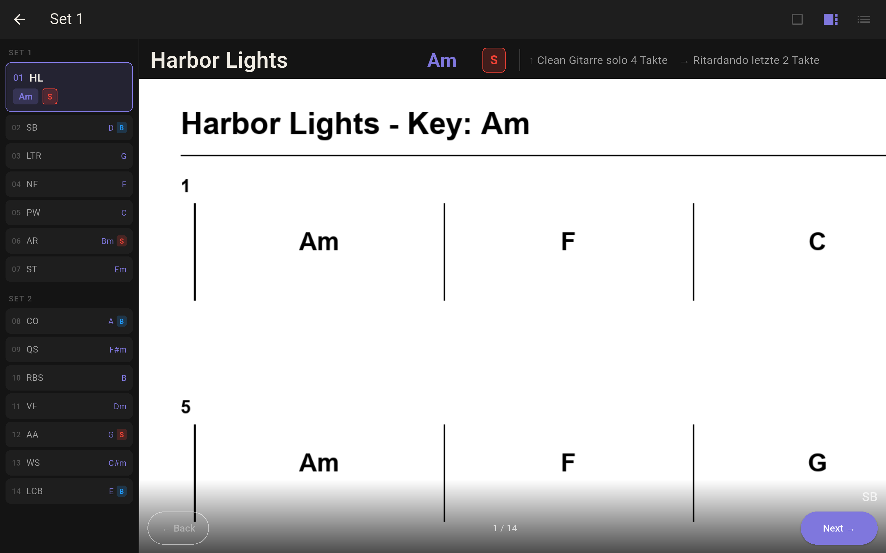
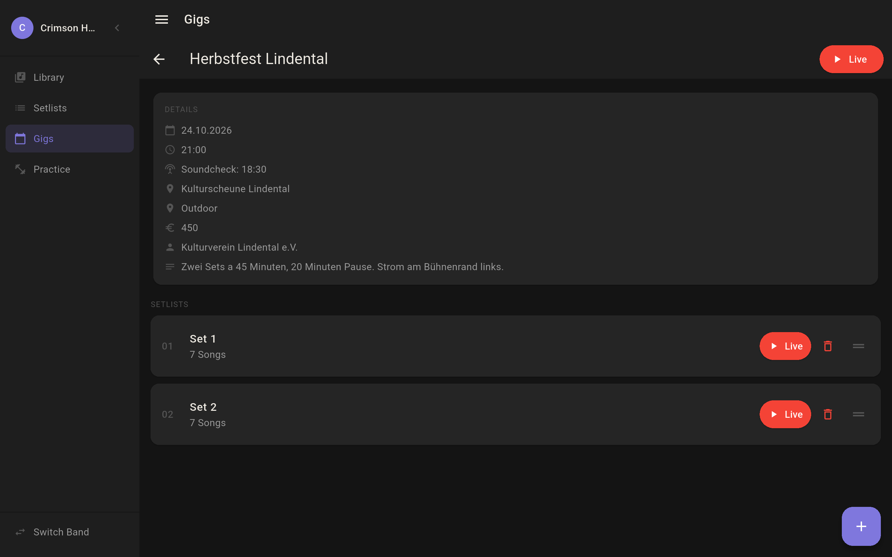

# Nota

Setlist manager for musicians, built for the stage. Flutter, tablet.



## Why

Paper setlists and PDF readers don't hold up on stage. Nota shows setlist, song info, and handwritten notes at the same time, with fixed positions for key and solo markers so the eye doesn't have to search on a song change.

## Features

- Bands, songs, setlists, gigs
- Handwritten notes per song (S Pen or finger), chord charts as PDF background
- Live mode in three variants (fullscreen, with sidebar, setlist only), swipe navigation
- Multiple sets per gig with a pause screen in between
- Practice list per song
- Backup and restore via your own Nextcloud server

## Screenshots



Gig detail with both sets of a show.

## Stack

- Flutter 3.41.6, Dart 3.11.4
- Provider ^6.1.5+1
- shared_preferences ^2.5.5

## Development

```bash
flutter pub get
flutter run
```

Target device: Samsung Galaxy Tab S6 Lite, landscape. The app is designed for tablet landscape layout.

## Status

Personal project, in live use, no release, not looking for contributions.
